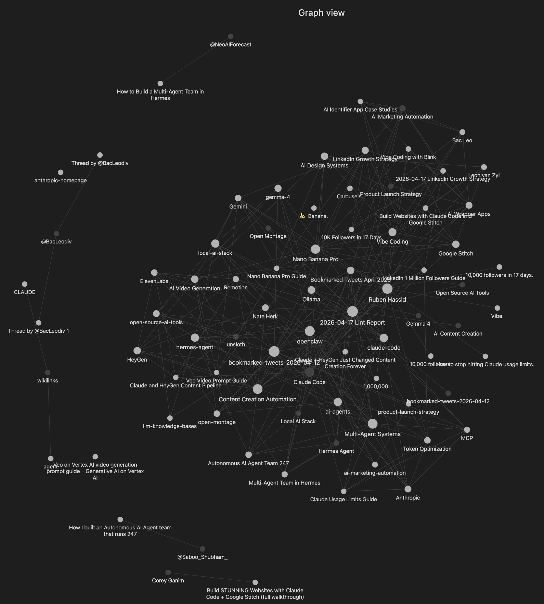
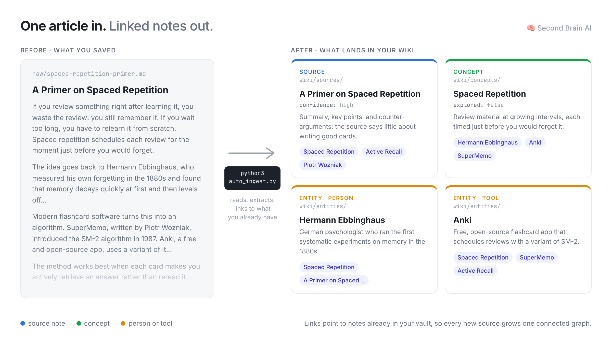

<div align="center">

# 🧠 Second Brain AI

### An always-on AI agent that reads your articles, videos, and tweets, files them into a self-organizing Obsidian wiki, and lets you query the result in plain English from any device.

**Paste a link to a Discord bot. Wake up to a connected knowledge graph. Your laptop can stay off.**

[](LICENSE)
[](#)
[](https://github.com/NousResearch/hermes-agent)
[](https://deepseek.com)
[](https://obsidian.md)
[](CONTRIBUTING.md)

**[Why](#why-this-exists)** ·
**[Pick a mode](#-pick-a-mode)** ·
**[Local quick start](#-local-quick-start-mac-5-minutes)** ·
**[Always-on setup](#-always-on-setup-linux-vps)** ·
**[Capture paths](#-capture-paths)** ·
**[Troubleshooting](#-troubleshooting)** ·
**[Cost](#-cost)** ·
**[Architecture](docs/ARCHITECTURE.md)** ·
**[Knowledge model](docs/KNOWLEDGE_MODEL.md)** ·
**[Security](docs/SECURITY.md)**

<br>



<sub>A real vault after a few weeks of clipping. Every node and link was written by the ingest agent.</sub>

</div>

---

## Why this exists

Most knowledge tools are write-only. You save bookmarks, drop notes, organize folders. The information piles up, but nothing connects to what you read last month. A year later, you can't find the one thread that mattered.

This project flips the model: **an AI agent maintains your knowledge base for you.** You feed it links from anywhere — Discord, a browser clipper, a drop-in folder. It reads the source, extracts entities and concepts, cross-links them to what already exists, resolves contradictions when new information conflicts with old, and logs every change.

You read the result in Obsidian, or query it in plain English by messaging a Discord bot from your phone.

Pattern inspired by Andrej Karpathy's [LLM-Wiki](https://gist.github.com/karpathy/442a6bf555914893e9891c11519de94f), extended along four axes:

1. **Always-on hosting** — runs 24/7 on a small Linux VPS, not on your laptop
2. **Multi-source capture** — articles, PDFs, video transcripts, X posts and bookmarks, drop-in files
3. **Agentic curation** — the agent resolves contradictions, tracks when facts were true ([bi-temporal](docs/KNOWLEDGE_MODEL.md#1-bi-temporal-facts)), writes Architecture Decision Records, links into existing pages instead of duplicating
4. **Ambient query** — you talk to it via Discord, on any device, in plain English

Total monthly cost runs **~$8–$15** for a single-person setup.

---

## ⚡ How it works

<picture>
  <source media="(prefers-color-scheme: dark)" srcset="docs/screenshots/before-after-dark.png">
  
</picture>

Under the hood, the always-on setup has four layers:

```
1. CAPTURE   →  how things enter the brain (5 paths into raw/)
2. PIPELINE  →  watcher → kanban → dispatcher → agent (24/7 on VPS)
3. AGENT     →  Hermes runtime + LLM + skills + tools (the brain)
4. VAULT     →  markdown wiki (source of truth)
```

This is a real agent loop, not a fixed script. Per ingest, the agent runs
**observe → plan → act → reason → persist → repeat** (typically 5–15 tool
calls per source). It self-corrects on failure: if a fetch times out, the
file stays in `raw/`, the watcher requeues it, the next run completes it.

**Full architecture:** [`docs/ARCHITECTURE.md`](docs/ARCHITECTURE.md) · **Visual diagram:** [`docs/diagrams/architecture.html`](docs/diagrams/architecture.html)

---

## 🧭 Pick a mode

There are two ways to run Second Brain AI. Both write the same markdown wiki, so you can start local and move to a server later without losing anything.

| | **Local mode** | **Always-on mode** |
|---|---|---|
| Runs on | Your Mac | A small Linux VPS |
| Setup time | ~5 minutes | ~30–60 minutes |
| Worker | `auto_ingest.py` (one LLM call per file) | Hermes agent (multi-step tool loop) |
| Capture | Drop files in `raw/`, browser bookmarklet, Obsidian Web Clipper | All of local, plus Discord bot, video, X/Twitter |
| Query | Obsidian, or Claude Code slash commands | Ask the Discord bot from any device |
| Schedule | Daily via launchd (or run by hand) | Real-time file watcher + systemd timers |
| Cost | $0 with a free OpenRouter model | ~$8–$15/month |

**New here? Start with local mode.** You'll have a working wiki in five minutes and can decide later whether you want the always-on setup.

**Just want to look first?** Open [`examples/demo-vault`](examples/) in Obsidian. It's a finished sample wiki on learning and note-taking, with no setup or API key needed.

---

## 💻 Local quick start (Mac, 5 minutes)

### 1. Install the basics

- [Python 3.10+](https://www.python.org/downloads/) (`python3 --version` to check)
- [Obsidian](https://obsidian.md) (free) to browse the wiki
- An LLM API key. Either:
  - **[OpenRouter](https://openrouter.ai/keys)** (default; has free models), or
  - **[DeepSeek](https://platform.deepseek.com/api_keys)** (paid, cheap, 1M context)
- Optional: `brew install poppler` for better PDF text extraction

### 2. Clone and run setup

```bash
git clone https://github.com/nitesht2/second-brain-ai.git
cd second-brain-ai
./setup.sh
```

`setup.sh` creates the vault at `~/SecondBrain/`, installs the Python dependencies, and registers these launchd jobs:

| Job | What it does |
|---|---|
| `com.secondbrain.ingest` | Runs `auto_ingest.py` daily at 4:07 AM |
| `com.secondbrain.server` | Keeps the bookmarklet save server running |
| `com.secondbrain.daily-digest` | Every morning, saves GitHub trending, Hacker News, and AI model news into `raw/generated/`, which the next ingest picks up |
| `com.secondbrain.weekly-review` | Runs a wiki health check on Sundays |
| `com.secondbrain.watcher` | Queues new `raw/` files for the Hermes agent. Does nothing unless Hermes is installed |

If you don't want a job, remove it with `launchctl unload ~/Library/LaunchAgents/<job>.plist` and delete the file.

<details>
<summary>Prefer not to install launchd jobs? Manual setup.</summary>

```bash
pip3 install -r requirements.txt
mkdir -p ~/SecondBrain/{raw/processed,wiki/{entities,concepts,sources,synthesis},outputs}
```

Then run `python3 auto_ingest.py` from the repo whenever you want to process new files.
</details>

### 3. Add your API key

Scheduled jobs don't read your shell profile, so put the key in `~/.secondbrain.env`:

```bash
cat > ~/.secondbrain.env <<'ENV'
OPENROUTER_API_KEY=sk-or-...
ENV
chmod 600 ~/.secondbrain.env
```

Using DeepSeek instead? Use `SECOND_BRAIN_PROVIDER=deepseek` and `DEEPSEEK_API_KEY=sk-...`. All settings are listed under [Configuration](#configuration).

### 4. Feed it something

Pick any of these:

- **Drop a file** into `~/SecondBrain/raw/`. It can be `.md`, `.pdf`, or `.txt`. A `.txt` whose first line is a URL is fetched: YouTube links get the transcript, GitHub links get the README, and any other link gets the article text.
- **Use the bookmarklet.** With the save server running (setup starts it, or run `python3 brain_server.py`), open <http://localhost:7331/setup> and drag the **→ Brain** button to your bookmarks bar. Click it on any page to save it.
- **Use [Obsidian Web Clipper](https://obsidian.md/clipper)** and set its save folder to `~/SecondBrain/raw/`. This works best for TikTok, Instagram, and X, which block scripts.

### 5. Run the ingest

```bash
python3 auto_ingest.py
```

Each file becomes 1–3 linked wiki entries (a source note plus any people, tools, or concepts it mentions). Processed files move to `raw/processed/`. Related entries are then grouped into `wiki/synthesis/` notes, and `wiki/index.md` is rebuilt.

### 6. Open it in Obsidian

Choose **Open folder as vault**, select `~/SecondBrain`, then open **Graph view**.

### Command reference

| Command | What it does |
|---|---|
| `python3 auto_ingest.py` | Ingest everything in `raw/`, then synthesize and rebuild the index |
| `python3 auto_ingest.py --dry-run` | Show what would happen without writing or moving anything |
| `python3 auto_ingest.py --synthesize` | Only regenerate the synthesis notes for clusters that changed |
| `python3 auto_ingest.py --synthesize --force-synthesis` | Regenerate every synthesis note |
| `python3 auto_ingest.py --save <url>` | Download a TikTok or Instagram video, transcribe it, and save it to `raw/` |
| `python3 brain_server.py` | Start the bookmarklet save server on `localhost:7331` |

Scheduled runs skip if the last run was under 24 hours ago. To force a run, delete `~/SecondBrain/outputs/.last_ingest_run`.

### Claude Code slash commands (optional)

If you use [Claude Code](https://claude.com/claude-code), install the bundled commands to ingest, query, lint, and synthesize from inside a session:

```bash
mkdir -p ~/.claude/commands
cp claude-commands/*.md ~/.claude/commands/
```

Then use `/second-brain` (setup wizard), `/second-brain-ingest`, `/second-brain-query <question>`, `/second-brain-lint`, and `/second-brain-synthesis`.

---

<a id="configuration"></a>

## ⚙️ Configuration

All settings are environment variables. Put them in `~/.secondbrain.env` (one `KEY=value` per line). Anything you `export` in your shell takes priority over the file.

| Variable | Default | Purpose |
|---|---|---|
| `SECOND_BRAIN_PROVIDER` | `openrouter` | `openrouter` or `deepseek` |
| `OPENROUTER_API_KEY` | — | Required when the provider is `openrouter` |
| `OPENROUTER_MODEL` | `openrouter/owl-alpha` | Any [OpenRouter model ID](https://openrouter.ai/models) |
| `DEEPSEEK_API_KEY` | — | Required when the provider is `deepseek` |
| `DEEPSEEK_MODEL` | `deepseek-chat` | DeepSeek model name |
| `SECOND_BRAIN_PATH` | `~/SecondBrain` | Where the vault lives |
| `NITESH_VOICE_PATH` | `~/.voice` | Optional folder of brand-voice `.md` files injected into every prompt (files starting with `_` are skipped) |

---

## 🚀 Always-on setup (Linux VPS)

Self-hosted system. You'll need a small Linux server, a Discord bot, and an LLM API key. Plan ~30–60 minutes for the first install.

### Prerequisites

- **VPS** — Ubuntu 22.04+, minimum 4 GB RAM (8 GB if you'll transcribe video on the VPS), ~20 GB disk
- **Discord bot** — create one at [discord.com/developers/applications](https://discord.com/developers/applications), invite to a server you own
- **LLM API key** — DeepSeek (cheapest), OpenRouter (flexible), or Anthropic (strongest reasoning)
- **Optional:** residential proxy (~$5 one-time for 5 GB) if you want to ingest YouTube/TikTok directly from the VPS — datacenter IPs are blocked by those platforms

### Install on the VPS

```bash
# 1. Install the Hermes agent runtime
curl -fsSL https://raw.githubusercontent.com/NousResearch/hermes-agent/main/scripts/install.sh | bash

# 2. Clone this repo, install vault-side deps
git clone https://github.com/nitesht2/second-brain-ai.git /opt/second-brain-ai
cd /opt/second-brain-ai
python3 -m venv .venv
.venv/bin/pip install -r requirements.txt -r requirements-vps.txt
sudo apt install -y inotify-tools ffmpeg

# 3. Follow the full step-by-step runbook
cat deploy/vps/README.md
```

**[`deploy/vps/README.md`](deploy/vps/README.md)** is the long-form deployment guide. It covers the agent profile setup, the systemd services, gateway lockdown, the obsidian MCP wiring, the optional proxy, and the X API auth modes.

### Optional: Mac capture bridge

To clip from Chrome on your Mac and have the VPS ingest it (using Obsidian Web Clipper):

```bash
brew install fswatch
# See deploy/mac/README.md for the full setup
```

Details: **[`deploy/mac/README.md`](deploy/mac/README.md)**

---

## 📥 Capture paths (always-on mode)

Five ways to feed the brain on the VPS. Pick whichever fits your workflow — you don't need all of them. For local mode, see [step 4 above](#4-feed-it-something).

| Source | How to capture | Notes |
|--------|---------------|-------|
| **Articles · blogs · docs · gists · PDFs** | DM the link to the Discord bot | `web_extract` handles fetching. Works from any device. |
| **Local files** (`.md`, `.txt`, `.pdf`) | Drop into `raw/` on the VPS | Useful for batch backfills. |
| **Browser one-click** | Obsidian Web Clipper → local `raw/` → fswatch → VPS | Best for staying in flow. See [`deploy/mac/`](deploy/mac/). |
| **Video** (YouTube · TikTok · IG · podcasts · 1000+ yt-dlp sites) | Paste link to bot, or run `deploy/vps/clip.py <url>` | YouTube tries captions first (fast, exact), falls back to local CPU whisper. |
| **X / Twitter** | Ask the bot ("search X for X", "save this thread", "show my bookmarks") | `xurl` CLI. Three auth modes covered: bearer (search), OAuth1 (timeline), OAuth2 (bookmarks). |

All five paths converge on a single drop zone (`raw/`). The watcher detects new files, the dispatcher queues an ingest task, the agent runs, processed files move to `raw/processed/`.

---

## 🧠 What the agent writes

Structured markdown with frontmatter that captures both content and provenance:

```yaml
---
confidence: high | medium | low
explored: false
valid_from: YYYY-MM-DD       # when the claim became true in the world
learned_on: YYYY-MM-DD       # when this vault first recorded it
last_verified: YYYY-MM-DD    # last time a re-ingest confirmed it
superseded_by: [[New Page]]  # optional
contradicts: [[Other Page]]  # optional
sources: [path/to/source.md, ...]
---
```

Three patterns differentiate this from a notes app:

- **[Bi-temporal facts](docs/KNOWLEDGE_MODEL.md#1-bi-temporal-facts)** — tracks *when something was true* separately from *when you learned it*. Time-travel queries; automatic drift detection (`last_verified > 180d` → re-check).
- **[Contradiction auto-resolve](docs/KNOWLEDGE_MODEL.md#2-contradiction-auto-resolve)** — when new info conflicts with old, the agent picks a winner, rewrites the page, moves loser content to `## Superseded`, and logs the change.
- **[Decision Records (ADRs)](docs/KNOWLEDGE_MODEL.md#3-decision-records-adrs)** — when the agent helps you pick between alternatives, it writes a lightweight ADR to `wiki/decisions/` so future-you can answer "why did I build it this way?"

Full schema and rationale: **[`docs/KNOWLEDGE_MODEL.md`](docs/KNOWLEDGE_MODEL.md)**. The bi-temporal facts and contradiction-resolve patterns are adapted from [eugeniughelbur/obsidian-second-brain](https://github.com/eugeniughelbur/obsidian-second-brain).

---

## 🩺 Troubleshooting

| Symptom | Fix |
|---|---|
| `OPENROUTER_API_KEY is not set` | Add the key to `~/.secondbrain.env` (see [step 3](#3-add-your-api-key)). If you use DeepSeek, also set `SECOND_BRAIN_PROVIDER=deepseek`. |
| `Last run was 2.3h ago (< 24h). Skipping.` | This is the daily gate. Delete `~/SecondBrain/outputs/.last_ingest_run` to run now. |
| A file stays in `raw/` | Its text couldn't be extracted (blocked page, no transcript, scanned PDF). The run output says why. Paste the text into a `.md` file instead. |
| Bookmarklet says "Save server not running" | Run `python3 brain_server.py`, or check `~/SecondBrain/outputs/server.log`. |
| YouTube transcript fails | The video may have no captions, or YouTube is blocking your IP. Use Web Clipper, or follow the proxy section of the [VPS runbook](deploy/vps/README.md). |
| PDF text is garbled or empty | `brew install poppler`. Scanned PDFs need OCR first. |
| Scheduled job isn't running | Check the logs in `~/SecondBrain/outputs/` and run `launchctl list \| grep secondbrain`. |

---

## 💰 Cost

**Local mode:** $0 with a free OpenRouter model, or cents per month on DeepSeek.

**Always-on mode:** **~$8 – $15 / month** for a single-person setup:

- **VPS** (small KVM, 2 vCPU / 8 GB): $5 – $8/mo
- **LLM** (DeepSeek Flash, auto-cached): <$1 – $5/mo · the variable
- **Optional:** residential proxy (~$5 one-time, never-expires), X API (~$1 – $3/mo if you query often)

The LLM is the only knob. Swapping DeepSeek for Claude or GPT-4 multiplies that line 5–10×.

---

## 🔒 Security model (summary)

- **Code in git, secrets on the server.** API keys, bot tokens, proxy creds live in `~/.hermes/profiles/<profile>/.env` (chmod 600). Never committed.
- **`.gitignore`** blocks `.env`, `*.env`, the vault itself.
- **Pre-commit hook** scans diffs for API-key patterns. Enable: `git config core.hooksPath .githooks`.
- **Gateway lockdown** — `gateway.allow_all_users: false` + Discord ID allowlist. Only authorized users can drive the bot.

Full details, rotation steps, and threat model: **[`docs/SECURITY.md`](docs/SECURITY.md)**

---

## 🤝 Contributing

Issues and PRs welcome. Areas where outside contributions would be especially useful:

- More capture-source adapters (Reddit, LinkedIn, RSS, email)
- Alternative LLM provider examples (Claude, Gemini, local Ollama)
- A web-based query UI for users who don't want Discord
- Better lint rules (richer orphan/drift detection)
- A Linux (systemd/cron) or Windows equivalent of the local-mode launchd jobs

See [CONTRIBUTING.md](CONTRIBUTING.md). Run the test suite before opening a PR:

```bash
pip install pytest
python3 -m pytest tests
```

---

**More:** [Architecture](docs/ARCHITECTURE.md) · [Knowledge model](docs/KNOWLEDGE_MODEL.md) · [Security](docs/SECURITY.md) · [Design notes](docs/DESIGN.md) · [Repo layout](docs/REPO_LAYOUT.md) · [Deployment runbook](deploy/vps/README.md) · [Diagram](docs/diagrams/architecture.html)

---

## 📄 License

MIT. Fork it, ship your version, send it back if you build something interesting.
